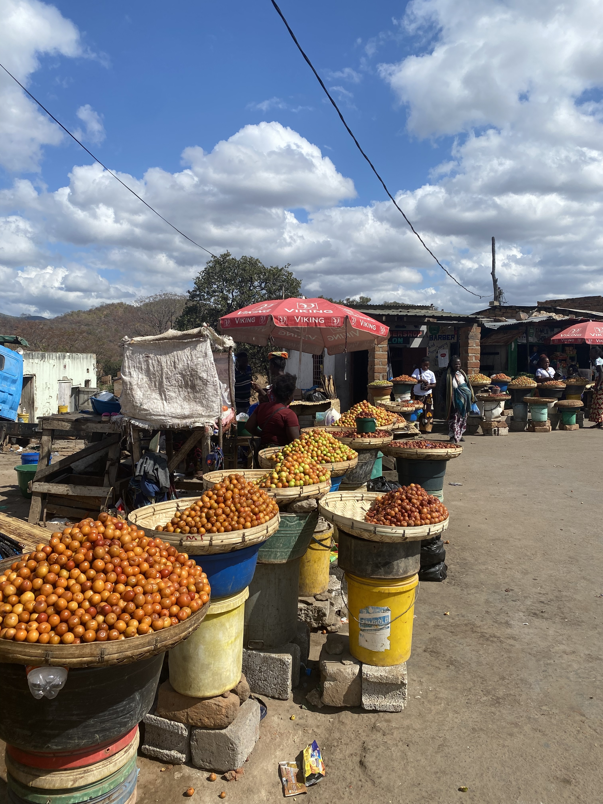
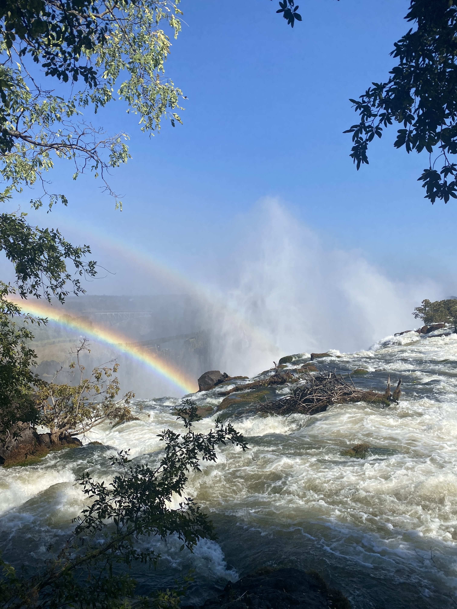
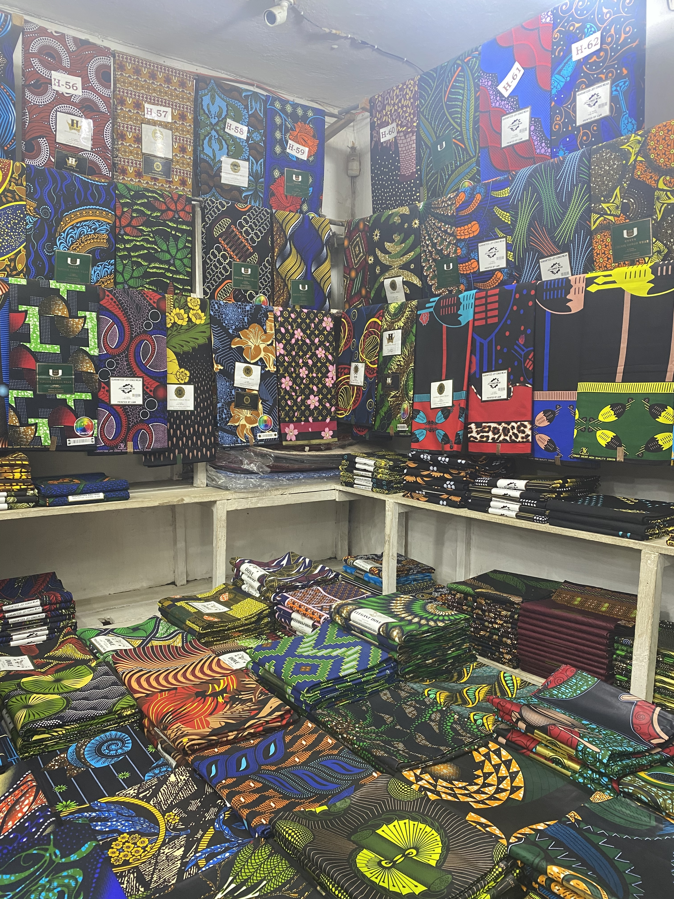
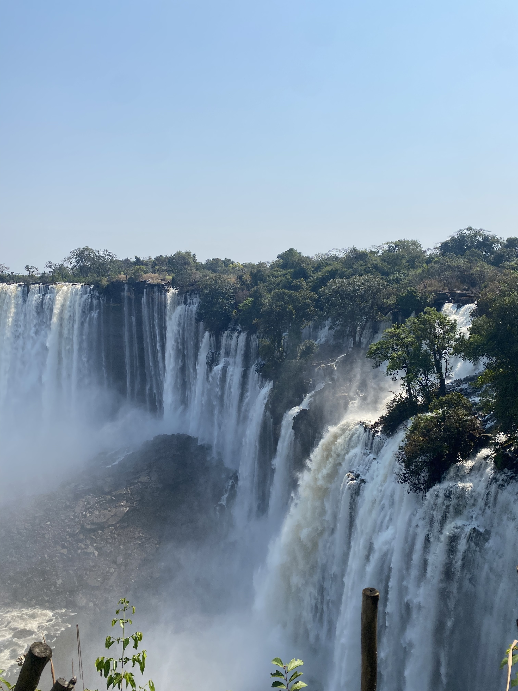

  
  
Luangwa, Zambia

  
  
Mosi-oa-Tunya National Park

  
  
Kamwala market, Zambia 

  
  
Kalandula Falls, Angola

<style>
.photo-grid {
  display: grid;
  grid-template-columns: repeat(2, 1fr);
  gap: 30px;
}

.photo-grid figure {
  background: white;
  padding: 12px;
  padding-bottom: 20px;
  box-shadow: 0 4px 12px rgba(0,0,0,.15);
  transform: rotate(-1deg);
}

.photo-grid figure:nth-child(even) {
  transform: rotate(1deg);
}

.photo-grid img {
  width: 100%;
  aspect-ratio: 1/1;
  object-fit: cover;
}

.photo-grid figcaption {
  text-align: center;
 